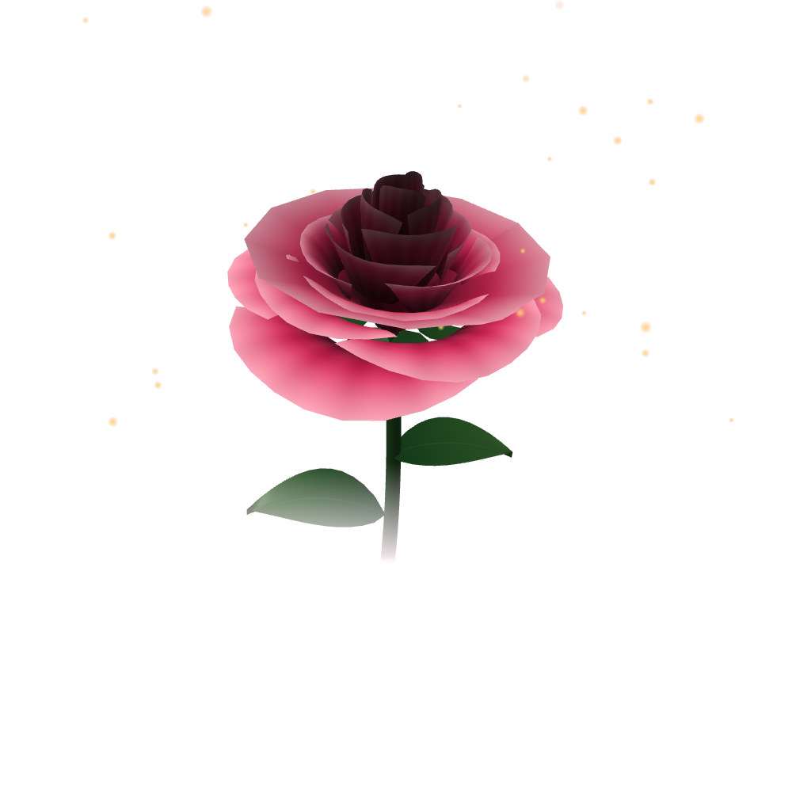

# Gulegul 3D rose hero

Drop-in replacement for the three.js rose in `.hero-art` on `index-new.html`.

- `rose.js` — dependency-free WebGL renderer (no three.js / CDN). Procedural rose: golden-angle petal spiral, sepals, stem, leaves, falling rose petals.
- `rose-poster.png` — pre-rendered frame, shown until WebGL is live and kept as the fallback (no WebGL, context loss).
- `index.html` — demo hero (Cormorant Garamond + Montserrat, pink/gold tokens from the ui-ux-pro-max design system).

## Use on the live page
```html
<div class="hero-art" data-rose role="img" aria-label="A slowly turning red rose">
  
</div>
<script src="rose.js" defer></script>
```
See `index.html` for the `.hero-art` CSS. The canvas is sized by its container (`position:absolute; inset:0`), never by the viewport, and `.hero-art` has `overflow:hidden; contain:layout paint` — this is what keeps the hero from clipping text or pushing the WhatsApp button out.

## Notes
- Bloom: the page shows a bud poster first; once loaded and idle the 3D rose fades in and opens (outer petals first, slight overshoot, ~2.4s), petals fall, then everything stops. Click/tap replays. `?b=0..1` pins the bloom, `?t=` or reduced-motion shows it fully open. Same idea as the delayed bloom on the live home page.
- Real footage: `data-video="rose-bloom"` on the hero loads `rose-bloom.webm` / `.mp4` (muted loop: bloom in, hold, bloom out). If missing or unsupported the 3D rose is used. The shipped clip is made from the supplied rose photo with a radial-warp script (ffmpeg + numpy), so it is a simulated bloom, not real footage.
- Quality tiers (low/medium/high) by screen width and CPU cores; `?q=low|medium|high` overrides.
- Pauses off-screen and on hidden tabs; `prefers-reduced-motion` renders one still frame; `?t=2` pins a frame (for screenshots).
- Patterns taken from 21st.dev "Lattice Hero" (container-sized canvas, adaptive quality, off-screen pause, damped pointer parallax). No 21st code is copied; 21st had no rose/flower component.
- Tested headless (SwiftShader): no horizontal overflow at 360/390/768/1440.
- Known: petal geometry is stylised/low-poly; there is a small see-through gap under the front outer petal at some angles.
